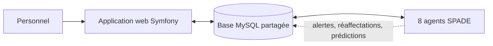

# smart-urgence-stage-ete

# 🚨 SmartUrgence

**Système multi-agents intelligent pour la coordination des flux patients aux urgences**
Projet réalisé lors d'un stage d'été chez **ESPRIT-TECH**, sur le terrain du service des urgences du **CHU Charles Nicolle (Tunis)**.


---

## 📌 Contexte et problématique

Le service des urgences reçoit en moyenne **424 patients par jour**. Une étude antérieure a identifié un goulot d'étranglement au niveau du **Box** : **57 minutes d'attente pour seulement 10 minutes de soin réel**. Les unités ne communiquent pas automatiquement entre elles face à une surcharge : un humain doit remarquer le problème, décider, puis agir.

> **Comment coordonner en temps réel, de façon automatique et décentralisée, les unités d'un service d'urgences, sans dépendre d'une supervision humaine continue ?**

## 💡 La solution

SmartUrgence combine deux composantes qui communiquent **uniquement via une base de données MySQL partagée** :

| Composante | Technologie | Rôle |
|---|---|---|
| 🌐 Application web | Symfony 7 (PHP), Doctrine, Twig | Interface pour le personnel, 5 rôles utilisateurs |
| 🤖 Système multi-agents | Python, SPADE (XMPP), SQLAlchemy | Coordination automatique en arrière-plan |



## 🤖 Les 8 agents

| Agent | Nombre | Rôle | Déclenchement |
|---|---|---|---|
| Agent Unité | 5 | Surveille la charge de sa salle (Accueil, Triage, Box, SAUV, UHCD), crée une alerte si le seuil est dépassé | Toutes les 10 s |
| Agent Coordinateur | 1 | Relaie les alertes vers l'Agent Ressource | À la réception d'un message |
| Agent Ressource | 1 | Trouve le personnel disponible (le moins sollicité) et crée une réaffectation | À la réception d'une demande |
| Agent Prédiction | 1 | Entraîne un modèle **XGBoost** sur l'historique et prédit le flux d'arrivées | Périodique |

**Chaîne de coordination automatique :**
`Unité saturée → Alerte → Message au Coordinateur → Demande à l'Agent Ressource → Réaffectation du personnel`

## 👥 Rôles de l'application

| Rôle | Fonctionnalités |
|---|---|
| `ROLE_ACCUEIL` | Enregistre les patients, génère leur QR code |
| `ROLE_TRIAGE` | Évalue la gravité (CIMU) et oriente vers l'unité adaptée |
| `ROLE_SOIGNANT` | Suit les patients de son unité, scan entrée/sortie, répond aux demandes de renfort |
| `ROLE_COORDINATEUR` | Tableau de bord global, alertes, prédictions, réaffectation manuelle |
| `ROLE_ADMIN` | Gestion des comptes, seuils des unités, supervision en lecture seule |

Chaque utilisateur ne voit que son interface (accès contrôlé côté serveur, erreur 403 sinon).

## 🗄️ Base de données

8 tables : `patient`, `passage`, `unite`, `personnel`, `utilisateur`, `alerte`, `reaffectation`, `prediction`.
La table **`passage`** est le pivot du système : chaque scan y crée ou met à jour une ligne, et les agents l'interrogent pour connaître l'état réel du service.

## 📁 Structure du dépôt

```
smarturgence/              # Application web Symfony
├── src/Controller/        # Un contrôleur par rôle
├── src/Entity/            # Entités Doctrine
├── src/Command/           # app:create-user, app:load-demo-data
└── templates/             # Interfaces Twig

agents_smarturgence/       # Système multi-agents Python
├── main.py                # Lance les 8 agents
├── agent_unite.py
├── agent_coordinateur.py
├── agent_ressource.py
├── agent_prediction.py
└── db.py                  # Connexion à la base partagée
```

## ⚙️ Installation

### Prérequis
PHP 8.2+, Composer, Symfony CLI, MySQL/MariaDB (XAMPP convient), Python 3.10+.

### 1. Application web

```bash
cd smarturgence
composer install
```

Configurer la base dans `.env` :

```dotenv
DATABASE_URL="mysql://root:@127.0.0.1:3306/smarturgence?serverVersion=10.4.32-MariaDB&charset=utf8mb4"
```

Créer le schéma, un compte administrateur et des données de démonstration :

```bash
php bin/console doctrine:database:create
php bin/console doctrine:schema:update --force
php bin/console app:create-user <email> <mot_de_passe> <nom> <prenom> ROLE_ADMIN
php bin/console app:load-demo-data
symfony server:start
```

> ⚠️ Les comptes de test sont réservés au développement : changez les mots de passe avant tout déploiement réel.

### 2. Système multi-agents

Dans un **second terminal** :

```bash
cd agents_smarturgence
python -m venv venv
venv\Scripts\activate          # Linux/Mac : source venv/bin/activate
pip install spade mysql-connector-python sqlalchemy xgboost pandas scikit-learn
python main.py
```

Vérifiez dans `db.py` que `DATABASE_URL` pointe vers la même base que Symfony.
Un serveur XMPP local est démarré automatiquement (`embedded_xmpp_server=True`) : inutile de lancer `spade run`.

## 🎬 Démonstration rapide

1. Lancer Symfony **et** les agents (deux terminaux).
2. Se connecter en **Admin** et baisser le seuil d'une unité (par exemple Accueil à 2).
3. Se connecter en **Accueil** et enregistrer 3 patients.
4. Observer dans la console des agents :

```
[AgentUnite:Accueil] SATURATION -> alerte creee
[AgentCoordinateur] Alerte recue
[AgentRessource] Reaffectation creee pour ...
```

5. Se connecter en **Coordinateur** : l'alerte et la réaffectation apparaissent sur le tableau de bord.

## ⚠️ Limites actuelles

- L'Agent Prédiction s'entraîne sur des données de démonstration, pas sur un historique réel de plusieurs mois.
- La sélection du personnel reste simple (le moins sollicité récemment).
- Les notifications passent par l'application web (pas de SMS ni d'e-mail).
- Le serveur XMPP local convient à une démo, pas à un déploiement réel.

## 🔭 Perspectives

- Canal de notification indépendant du site (SMS, e-mail)
- Ajout de la météo comme variable du modèle de prédiction
- Algorithme d'optimisation plus poussé pour le choix du personnel
- Serveur XMPP dédié pour un déploiement en conditions réelles

## 🌍 Objectifs de Développement Durable

**ODD 3** (Bonne santé et bien-être), avec des retombées sur l'**ODD 9** (Innovation) et l'**ODD 10** (Inégalités réduites).

## 👩‍💻 Auteure

**Chaima Mazitti** : stage d'été chez **ESPRIT-TECH**, encadré par **Yosra Jmal**.
